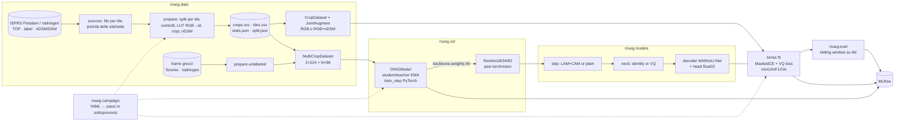

# Architettura

Il documento descrive il pacchetto `rsseg` (*Remote Sensing SEGmentation*), implementato con **Keras 3 su
backend PyTorch** e con tracking degli esperimenti su **MLflow**. Le motivazioni delle scelte sono in
[ANALISI_TESI.md](ANALISI_TESI.md) e [REVISIONE_CODICE_ORIGINALE.md](REVISIONE_CODICE_ORIGINALE.md).
L'esecuzione su GPU locale è descritta in [GPU_LOCALE.md](GPU_LOCALE.md), i dati in [DATASET.md](DATASET.md),
test ed esperimenti con i tempi di esecuzione in [ESECUZIONE_E_TEMPI.md](ESECUZIONE_E_TEMPI.md).

## 1. Obiettivi e vincoli

| Obiettivo | Conseguenza architetturale |
|---|---|
| Ritestare le ipotesi della tesi (LAM, VQ, DINO) in modo pulito | Parti ortogonali e combinabili da configurazione: `backbone × skip × neck × pre-training` |
| Riproducibilità | Seed globale, config salvata con ogni run, split deterministici per tile, manifest dei dati, commit git registrato su MLflow |
| Confrontabilità con la letteratura | Split standard di Potsdam e Vaihingen, valutazione su tile intere con etichette piene ed eroded, matrice di confusione globale |
| Singola GPU da 8 GB (RTX 4060) | bf16 mixed precision, accumulo del gradiente, crop 512, `rsseg benchmark` per misurare la VRAM |
| Molti esperimenti, lunghi | Campagne YAML riprendibili (`rsseg campaign`), un sottoprocesso per passo, early stopping, top-k checkpoint |
| Manutenibilità | Pacchetto installabile, test automatici, ruff, CI |

### Stack

| Livello | Scelta | Perché |
|---|---|---|
| Modelli e training | **Keras 3** (`keras.Model`, `fit`, callback) | API ad alto livello richiesta. Modelli funzionali leggibili, salvataggio dei pesi `.weights.h5`. |
| Backend | **PyTorch** (`KERAS_BACKEND=torch`, impostato da `import rsseg`) | CUDA maturo sulle GPU consumer, pesi ImageNet di torchvision, `DataLoader` accettato direttamente da `fit` |
| Tracking | **MLflow** (default `sqlite:///mlflow.db`) | Parametri, metriche per epoca, artefatti (checkpoint, report, figure), confronto tra run |
| Dati | PyTorch `Dataset`/`DataLoader`, Pillow, NumPy | Caricamento parallelo con i worker. Nessuna dipendenza da TensorFlow. |
| Configurazione | Dataclass tipizzate + YAML componibili (`base:`) + override `--set k=v` | Nessuna dipendenza pesante, chiavi sconosciute rifiutate |
| Terminale | **rich** | Log colorati, barre di avanzamento (epoche, preparazione, valutazione), tabelle dei risultati |

## 2. Vista d'insieme



## 3. Struttura del repository

```
.
├── LICENSE  README.md  CITATION.cff  pyproject.toml
├── configs/
│   ├── base.yaml                 # default dimensionati per GPU da 8 GB
│   ├── smoke.yaml                # run end-to-end su dati sintetici (CPU)
│   ├── datasets/vaihingen.yaml   # dati di Vaihingen (base degli esperimenti vaihingen_*)
│   ├── experiments/              # griglia della tesi, U-Net, thesis2022, Swin/ViT, nDSM, Vaihingen
│   ├── ssl/                      # DINO R18/R34/ViT-S16, con i pool Toronto/Vaihingen
│   └── campaigns/                # campagne di esperimenti per domanda di ricerca (rsseg campaign)
├── src/rsseg/
│   ├── __init__.py               # imposta KERAS_BACKEND=torch
│   ├── config.py                 # dataclass + YAML + override
│   ├── runtime.py                # precisione (bf16/fp16/fp32), seed, flag CUDA
│   ├── tracking.py               # run MLflow, parametri, ambiente, callback metriche/VRAM
│   ├── console.py                # output rich: logging, barre di avanzamento, tabelle
│   ├── cli.py                    # rsseg synth|prepare|prepare-unlabeled|train|pretrain|evaluate|benchmark|report|campaign|backbones
│   ├── campaign.py               # campagne: espansione YAML, prerequisiti, store condiviso, ripresa, report
│   ├── data/
│   │   ├── classes.py            # classi, palette, LUT vettorizzata, mapping legacy
│   │   ├── sources.py            # layout dei file ISPRS (Potsdam, Vaihingen), priorità delle etichette
│   │   ├── splits.py             # protocolli standard / thesis2022, split di Vaihingen
│   │   ├── prepare.py            # tile → crop + maschere (piene ed eroded) + nDSM + manifest + statistiche; dry run
│   │   ├── ndsm.py               # nDSM ufficiale o calcolato dal DSM (apertura morfologica)
│   │   ├── unlabeled.py          # crop non etichettati dai frame grezzi (anche 16 bit) per DINO
│   │   ├── datasets.py           # CropDataset (RGB o RGB+nDSM), MultiCropDataset, label_fraction per tile
│   │   ├── transforms.py         # augment congiunte, multi-crop DINO (anche "aerial")
│   │   └── synthetic.py          # tile sintetiche con gli stessi nomi di file di Potsdam e Vaihingen
│   ├── models/
│   │   ├── backbones.py          # ResNet Keras con nomi layer = torchvision, registro BACKBONES, input a N canali
│   │   ├── transformers.py       # Swin Transformer e ViT (+ simple feature pyramid)
│   │   ├── torchvision_weights.py# porting pesi ImageNet da torchvision (ResNet, Swin, ViT)
│   │   ├── attention.py          # LinearPAM (LAM), ChannelAttention, blocco PAM/CAM
│   │   ├── quantizer.py          # VectorQuantizer (EMA in variabili, init dai dati, restart)
│   │   └── segmentor.py          # build_segmentor(ModelConfig)
│   ├── ssl/
│   │   ├── dino.py               # head, loss per campione, schedule, DINOModel.train_step
│   │   └── train.py              # pretrain_dino + monitor di collasso + export backbone
│   ├── train/
│   │   ├── losses.py             # MaskedSparseCrossEntropy (ignora solo 255)
│   │   ├── metrics.py            # mIoU / mF1 / OA da matrice di confusione globale
│   │   ├── callbacks.py          # TopKCheckpoint, CodebookMonitor, PredictionLogger, RichProgressBar
│   │   └── seg_train.py          # train_segmentation, evaluate_segmentation
│   └── eval/
│       ├── sliding_window.py     # inferenza su tile intere con finestre sovrapposte
│       ├── report.py             # report JSON/MD, aggregazione media ± std
│       ├── visualize.py          # pannelli TOP | GT | pred | errori
│       └── benchmark.py          # picco VRAM e throughput di una configurazione
├── scripts/run_thesis_grid.sh    # wrapper di rsseg campaign configs/campaigns/thesis_grid.yaml
├── tests/                        # 74 test (unit + end-to-end su dati sintetici)
├── docs/
└── legacy/                       # materiale originale 2022, invariato
```

## 4. Componenti

### 4.1 Dati (`rsseg.data`)
- **`classes.py`** è l'unica fonte di verità per le classi. L'ordine è quello ISPRS/MMSegmentation, con **clutter per
  ultimo (indice 5)**. I colori sconosciuti diventano `255` (ignorato). La conversione RGB→id avviene con
  `searchsorted` su codici a 24 bit, senza loop per pixel.
- **`sources.py`** descrive per ogni dataset quale file è l'immagine, l'etichetta (piena ed eroded), l'nDSM e il DSM di
  ogni tile, con espressioni regolari sul percorso **in ordine di priorità**: per Potsdam `5_Labels_for_participants`
  prima di `5_Labels_all`, dove 4_12 è corrotta e 6_7 ha colori sbagliati (dettagli in [DATASET.md](DATASET.md)).
- **`prepare.py`** assegna prima le **tile** agli split e poi taglia i crop, così nessun crop attraversa due split.
  La sovrapposizione (`train_stride < crop_size`) è ammessa solo nel train. Rifiuta le etichette con troppi colori
  fuori palette e allinea le dimensioni (tolleranza 2 px). Le tile di val/test vengono registrate intere, con la
  maschera piena e quella eroded, per la valutazione a finestra scorrevole. Con `data.ndsm` scrive i crop nDSM come
  file a parte, così lo stesso root serve esperimenti RGB e RGB+nDSM. Le statistiche di normalizzazione sono
  calcolate solo sul train. `split.json` registra le impostazioni (dataset, protocollo, crop, nDSM) e le campagne
  lo usano per non riusare un root incompatibile. `--dry-run` (`inspect_dataset`) controlla tutto senza scrivere.
- **`ndsm.py`**: nDSM in decimetri (`uint8`, saturazione a 25,5 m). Quello ufficiale di Potsdam oppure quello
  calcolato dal DSM (minimo per cella di ~1 m, apertura morfologica con finestra di ~30 m, smoothing).
- **`unlabeled.py`** (`rsseg prepare-unlabeled`): crop di 512 dai frame grezzi di Toronto (RGB 8 bit) e Vaihingen
  (IR-R-G 16 bit, letti con `tifffile` e riportati a 8 bit con uno stretch a percentili). `source.json` registra la
  città, usata dalla guardia anti-leakage del pre-training.
- **Normalizzazione dentro il modello.** I dataset restituiscono immagini `float32` in `[0, 255]`, channels-last, e il
  primo layer del backbone applica media e deviazione standard ImageNet. L'inferenza quindi non può dimenticare
  la normalizzazione (bug S4 del 2022).
- **`label_fraction`** campiona i crop etichettati **per tile** con seed fisso, per il regime a poche etichette (RQ3).

### 4.2 Modelli (`rsseg.models`)

```
image ─► Backbone ─► [C1, C2, C3, C4] ─► skip(Ci) ─► Neck(C4) ─► Decoder(+ skip) ─► Head ─► logits (B, H, W, 6) float32
```

| Parte | Varianti | Note |
|---|---|---|
| Backbone | `resnet18`, `resnet34`, `resnet50` | Scritto in Keras (in `keras.applications` mancano R18/R34). Pesi `imagenet` portati da torchvision con equivalenza numerica testata, `none`, oppure un file `.weights.h5` (per esempio il backbone DINO). |
| Backbone Swin | `swin_t`, `swin_s`, `swin_b` | Swin Transformer v1: attenzione a finestre 7×7 (shifted) con bias di posizione relativa, patch merging. Gli stadi hanno già stride 4/8/16/32; ogni uscita passa da una LayerNorm (l'ultima è quella ImageNet). Padding delle finestre e maschera dello shift identici a torchvision (equivalenza testata anche su mappe non multiple della finestra). |
| Backbone ViT | `vit_s_16`, `vit_b_16`, `vit_l_16` | ViT pre-norm, patch 16. I blocchi `depth/4 · k` formano i quattro livelli tramite la *simple feature pyramid* (ConvT ×2 due volte, ConvT ×2, identità, max-pool 2×2); canali `D/4, D/2, D, D`. Gli embedding di posizione (224²) vengono interpolati bicubicamente alla griglia dell'input. `vit_s_16` non ha pesi ImageNet in torchvision: si usa con `weights: none` o con il backbone DINO. |
| Skip | `lam` (MAResU-Net: conv → LinearPAM ‖ ChannelAttention → 1×1), `plain` (identità) | `gamma` inizializzato a 0. Matematica dell'attenzione in float32. |
| Neck | `identity`, `vq` | `VectorQuantizer`: straight-through, commitment β, EMA oppure codebook appreso per gradiente, init dal primo batch, restart dei codici morti, `perplexity`/`usage`. Proiezione 1×1 se `code_dim` è diverso dai canali. Con `vq.on_skips=true` si quantizzano anche le skip. |
| Decoder | 4 blocchi 1×1 → ConvT 3×3 s2 → 1×1 (BN+ReLU), somma con la skip | Come MAResU-Net |
| Head | ConvT 4×4 s2 → conv 3×3 → conv 3×3 (float32) | Logit sempre in float32 anche con mixed precision |

**Input a N canali (nDSM).** Con `data.ndsm` il modello riceve 4 canali: `input_norm` usa ImageNet per RGB e
media/deviazione dell'nDSM calcolate sul train (`stats.json`, salvate nella config del run). I pesi di un encoder a 3
canali (ImageNet o DINO) vengono caricati e poi il primo layer (`conv1`, `patch_embed`) viene **gonfiato**:
il canale extra riceve la media dei kernel RGB (`model.extra_channel_init: mean`) o zero (`zeros`, e allora la rete
calcola esattamente quello che calcolava la versione RGB; è verificato da un test). DINO resta a 3 canali.

Nei transformer `model.drop_path` (e `ssl.drop_path` per DINO) è il tasso massimo di stochastic depth,
crescente linearmente con la profondità. Tabelle di bias relativo, embedding di posizione e class token
sono esclusi dal weight decay di AdamW. `rsseg backbones` elenca tutti gli encoder.

Correzioni rispetto al 2022, garantite dal design:
- nessun modulo costruito come argomento di default (bug V1): ogni `build_*` crea istanze nuove;
- lo stato EMA del codebook sta in variabili non addestrabili aggiornate con `assign` (bug V2);
- la VQ loss viene registrata con `add_loss` e sommata da Keras alla CE, senza clipping euristici (V3).

### 4.3 Self-supervised (`rsseg.ssl`)
`DINOModel` è un `keras.Model` con `train_step` scritto per il backend PyTorch (`loss.backward()`, `optimizer.apply`):

```
viste globali (2×224) ─► teacher (no grad) ─► GAP ─► head ─► softmax((z − c)/τ_t)
tutte le viste       ─► student            ─► GAP ─► head ─► log_softmax(z/τ_s)
loss = media sul batch di Σ_{g} Σ_{v≠g} CE(P_t(g), P_s(v)) / n_coppie        (per campione)
teacher ← m·teacher + (1−m)·student   (m: coseno 0.996 → 1, include le statistiche BN)
c ← λ·c + (1−λ)·media_batch(z_teacher)
```

- Il teacher nasce come copia esatta dello student (`set_weights`) ed è `trainable=False`.
- Schedule coseno per learning rate (con warmup e scaling `lr × batch/256`), weight decay (0.04 → 0.4) e momentum.
  Warmup lineare della temperatura del teacher. `global_clipnorm`.
- L'ultimo layer della head è una `WeightNormDense` (colonne normalizzate, come `norm_last_layer=True`).
- A fine training viene esportato **solo il backbone dello student** in `.weights.h5`, caricabile con `model.weights=<path>`.
- `teacher_entropy` viene loggata a ogni epoca: se tende a 0 il modello sta collassando.
- `ssl.extra_pools` aggiunge ai crop di training i pool non etichettati. Un pool della stessa città di
  `data.dataset` (i frame di Vaihingen coprono le sue aree di test) viene rifiutato, salvo
  `ssl.allow_same_city_pool`.

### 4.4 Training supervisionato (`rsseg.train`)
- `model.compile(optimizer=AdamW(gradient_accumulation_steps=...), loss=MaskedSparseCrossEntropy, metrics=[miou, mf1, oa, miou_no_clutter])`.
- La loss ignora **solo** il valore `255`: la classe clutter viene addestrata. C'è un test di regressione per il bug S1.
- Le metriche sono `keras.metrics.Metric` che accumulano una matrice di confusione `float64` sull'intero split.
- Scheduler per epoca: `step` (StepLR 15/0.4 come nella tesi), `cosine`, `constant`.
- Callback, in ordine: `EarlyStopping` (su `val_miou`, `train.early_stopping_patience`, default 20 epoche;
  `null` lo disattiva), `LearningRateScheduler`, `TopKCheckpoint`, `CodebookMonitor`, `GPUMemoryLogger`,
  `PredictionLogger`, `CSVLogger`, `MLflowMetricsLogger` (ultimo, così registra anche le voci aggiunte dagli altri).
- `TopKCheckpoint` tiene in `<run>/checkpoints/` i pesi delle `train.keep_top_k` epoche (default 5) con la
  `val_miou` più alta (`epoch_NNN_val_miou_X.XXXX.weights.h5`, elenco in `topk.json`) e copia il migliore in
  `<run>/best.weights.h5`. La patience di default è più lunga dello `step_size` dello scheduler (15): un calo
  del learning rate spesso fa ripartire i miglioramenti. La config `thesis2022` disattiva l'early stopping, come
  nella tesi.
- A fine training si ricaricano i pesi migliori, si valuta su tile intere e si registra il report su MLflow.

### 4.5 Valutazione (`rsseg.eval`)
- `predict_tile`: finestre (512, stride 256) con fusione delle softmax pesata da una finestra di Hann e padding
  riflesso per le tile piccole. Il buffer delle probabilità sta sulla CPU, sulla GPU va un batch di finestre alla
  volta. TTA con flip opzionale.
- Il report ha lo stesso formato delle tabelle 4.3–4.8 della tesi (IoU, F1, precision e recall per classe; OA, mF1,
  mIoU), calcolato sia con tutte le classi sia senza clutter, e sia con le etichette piene sia con quelle **eroded**
  (bordi ignorati, riferimento del benchmark ISPRS): una sola predizione per tile, due matrici di confusione.
  Le definizioni coincidono con il tool ufficiale ISPRS. `rsseg report` aggrega media ± deviazione standard sui seed.
- `rsseg benchmark` esegue passi di training reali su dati casuali e misura il picco di VRAM e le immagini al secondo.

### 4.6 Campagne (`rsseg.campaign`)
Una campagna (`configs/campaigns/*.yaml`) elenca esperimenti, seed, sweep (prodotto cartesiano di valori di config),
backbone DINO, pool non etichettati e benchmark; `include` unisce più campagne (`all.yaml`). `rsseg campaign`:

1. espande tutto in passi con un id stabile (`<nome>__s<seed>`) e valida le config prima di spendere tempo GPU;
2. prepara ciò che manca: pool (`prepare_unlabeled`) e dati (`inspect_dataset` senza errori, poi `prepare_dataset`),
   raggruppando i run per `data.root` e rifiutando un root preparato con impostazioni diverse;
3. stima il disco (checkpoint top-k con lo stato dell'ottimizzatore) e si ferma se non basta;
4. esegue pre-training, training e benchmark, **ognuno in un sottoprocesso** `python -m rsseg.cli …` con il log in
   `log.txt`: un crash o un out-of-memory ferma solo quel passo, e i run che dipendono da un pre-training fallito
   risultano `blocked`;
5. scrive `status.json` e `report.md` della campagna (solo i suoi run: media ± std, eroded, benchmark, errori).

I passi vivono in uno **store condiviso** (`runs/campaigns/store/{backbones,runs,benchmarks}/<id>/`, con `spec.json` e
`outcome.json`): un passo completato viene saltato, quindi una campagna interrotta riprende e un run comune a più
campagne viene addestrato una volta. Uno `spec.json` diverso con lo stesso id blocca la campagna. `--quick` usa uno
store separato (`runs/campaigns-quick/`).

## 5. Configurazione

Le YAML ereditano con `base:` e i valori si sovrascrivono da riga di comando:

```bash
rsseg train -c configs/experiments/maresunet_vq_r18_imagenet.yaml \
  --set train.batch_size=4 train.grad_accum_steps=8 model.vq.num_codes=256 name=vq256
```

Le sezioni sono `data`, `model` (con `vq`), `train`, `eval`, `ssl`, `tracking`: vedi `src/rsseg/config.py`, dove ogni
campo è documentato.

## 6. Qualità

| Livello | Cosa si verifica |
|---|---|
| Equivalenza | Backbone Keras = torchvision (R18/R34, pesi casuali, statistiche BN casuali; Swin su mappe con padding e shift parziale; encoder ViT). LinearPAM = trascrizione NumPy della formula originale e = attenzione esplicita `1 + q̂·k̂`. CAM = riferimento NumPy. |
| Invarianti | Split disgiunti (Potsdam, Vaihingen), LUT biunivoca, allineamento immagine/maschera dopo l'augmentation, `label_fraction` deterministico |
| Dati reali | Priorità delle etichette e rifiuto di quelle corrotte (difetti di 4_12 e 6_7 riprodotti), pad 5999→6000, nDSM calcolato (pendenza rimossa, altezza recuperata), maschere eroded, pool a 16 bit con stretch, guardia anti-leakage |
| Input a 4 canali | Encoder gonfiato con init `zeros` = encoder RGB (ResNet, Swin, ViT); training end-to-end con nDSM |
| VQ | Gradiente straight-through = identità. Loss solo in training. L'EMA ritrova i centri di cluster noti con perplexity alta. |
| DINO | Loss = media delle loss per campione (nessun mescolamento). Teacher = copia iniziale, non addestrabile, aggiornato per EMA. Schedule. |
| Metriche | Metriche Keras accumulate su più batch = NumPy sulla stessa matrice di confusione |
| End-to-end | synth → prepare → train → report → MLflow → pretrain DINO → fine-tuning dal backbone esportato |
| Campagne | Espansione, errori di definizione, ripresa, passi falliti e bloccati, controlli su dati e disco (runner finto); una campagna reale con 3 sottoprocessi |
| Checkpoint | `TopKCheckpoint` tiene i k migliori e copia il migliore |
| CI | GitHub Actions: ruff (lint + format) e pytest su Python 3.11/3.12 con PyTorch CPU |

## 7. Licenza

Il codice è distribuito sotto **GNU AGPL v3.0 o successiva** (`AGPL-3.0-or-later`, vedi `LICENSE`). Ogni file sorgente
ha l'intestazione SPDX. Il materiale in `legacy/` mantiene la propria licenza (Apache-2.0 per il codice,
tutti i diritti riservati per tesi e slide). Pesi torchvision e dataset ISPRS seguono le rispettive condizioni.
