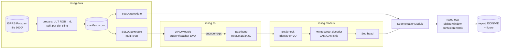

# Architettura della nuova implementazione

> Stato: **progetto**. Il documento descrive l'architettura prevista del pacchetto `rsseg`
> (*Remote Sensing SEGmentation*), che sarà sviluppato da zero secondo il [piano di sviluppo](PIANO_DI_SVILUPPO.md).
> Le motivazioni delle scelte sono in [ANALISI_TESI.md](ANALISI_TESI.md) e [REVISIONE_CODICE_ORIGINALE.md](REVISIONE_CODICE_ORIGINALE.md).

## 1. Obiettivi e vincoli

| Obiettivo | Conseguenza architetturale |
|---|---|
| Ritestare le ipotesi della tesi (LAM, VQ, DINO) in modo **pulito** | Componenti ortogonali e combinabili da configurazione: `backbone × bottleneck × pretraining` |
| **Riproducibilità** | Seed globale, config versionata e salvata con ogni run, split deterministici, manifest dei dati |
| **Confrontabilità** con la letteratura | Split standard di Potsdam, valutazione su tile intere con matrice di confusione globale |
| Efficienza (motivazione energetica della tesi) | Report automatico di parametri, FLOPs e latenza; mixed precision; backbone piccoli di default |
| Manutenibilità | Pacchetto installabile, typing, test, CI, nessun percorso cablato |

Stack previsto: Python ≥ 3.11, PyTorch ≥ 2.3, Lightning ≥ 2.3 (`LightningCLI`), torchvision (pesi dei
backbone), torchmetrics, TensorBoard/CSV logger (W&B opzionale), `uv` per l'ambiente, `ruff` e `mypy`,
`pytest`.

## 2. Vista d'insieme



## 3. Struttura del repository

```
.
├── LICENSE                     # AGPL-3.0
├── README.md
├── pyproject.toml              # pacchetto rsseg, dipendenze, ruff/mypy/pytest
├── configs/
│   ├── data/                   # potsdam_standard.yaml, potsdam_thesis2022.yaml
│   ├── model/                  # maresunet_r18.yaml, maresunet_vq_r18.yaml, unet_r18.yaml, ...
│   ├── ssl/                    # dino_r18.yaml, ...
│   └── experiments/            # griglia della tesi e ablation (composizione dei precedenti)
├── src/rsseg/
│   ├── data/
│   │   ├── classes.py          # enum classi, palette, LUT, mapping legacy ↔ nuovo
│   │   ├── prepare.py          # CLI: tile grezze → crop + manifest
│   │   ├── splits.py           # protocolli standard / thesis2022, label_fraction
│   │   ├── datasets.py         # CropDataset, TileDataset (per sliding window)
│   │   ├── transforms.py       # augmentation congiunte img/mask, multi-crop DINO
│   │   └── datamodules.py      # SegDataModule, SSLDataModule
│   ├── models/
│   │   ├── backbones.py        # wrapper torchvision ResNet → feature piramidali [C1..C4]
│   │   ├── attention.py        # LinearPAM (LAM), CAM, PAMCAMBlock
│   │   ├── quantizer.py        # VectorQuantizer (EMA come buffer), dead-code restart, statistiche
│   │   ├── decoder.py          # DecoderBlock, MAResUNetDecoder (attenzione on/off)
│   │   ├── segmentor.py        # EncoderDecoder: backbone + neck + decoder + head
│   │   └── registry.py         # build_model(cfg) → nn.Module
│   ├── ssl/
│   │   ├── heads.py            # DINOHead (MLP → bottleneck → prototipi K, weight-norm)
│   │   ├── loss.py             # DINOLoss (per campione, centering, schedule temperatura)
│   │   ├── schedules.py        # cosine lr / wd / momentum
│   │   └── module.py           # DINOModule (LightningModule)
│   ├── train/
│   │   ├── seg_module.py       # SegmentationModule: loss CE(+VQ), metriche, logging
│   │   ├── losses.py           # CE pesata, Dice opzionale, composizione con VQ loss
│   │   └── callbacks.py        # codebook monitor, image logger, checkpoint "best mIoU"
│   ├── eval/
│   │   ├── sliding_window.py   # inferenza su tile intere con overlap e fusione
│   │   ├── metrics.py          # wrapper torchmetrics: OA, IoU/F1 per classe, mIoU, mF1
│   │   ├── efficiency.py       # parametri, FLOPs, latenza, memoria
│   │   └── report.py           # tabelle MD/CSV nel formato delle tabelle della tesi
│   └── cli.py                  # entrypoint: rsseg prepare | fit | pretrain | test | report
├── scripts/                    # lancio della griglia di esperimenti, aggregazione dei risultati
├── tests/                      # unit test (shape, invarianti, metriche), smoke test end-to-end
├── docs/                       # questa documentazione
└── legacy/                     # (fase 0) codice e materiali originali del 2022, invariati
```

## 4. Componenti

### 4.1 Dati (`rsseg.data`)
- **`classes.py`** è l'unica fonte di verità per nomi, colori e indici delle classi. La LUT RGB→id è
  vettorizzata (`np.ndarray` 2²⁴ o hashing dei triplet). I colori sconosciuti vanno a `ignore_index = 255`.
- **`prepare.py`** è idempotente e fa lo split **per tile prima** del tiling, poi scrive il manifest con
  l'istogramma delle classi per ogni crop. Serve per il campionamento bilanciato e per le statistiche.
- **`TileDataset`** restituisce tile intere per validation e test. La valutazione avviene su tile, non su crop.
- **Invarianti testati**: nessun `tile_id` in due split, maschere solo in `{0..5, 255}`, immagine e maschera
  allineate dopo l'augmentation.

### 4.2 Modelli (`rsseg.models`)
Il segmentatore è composto da tre parti intercambiabili:

```
x ─► Backbone ─► [C1, C2, C3, C4] ─► Neck(C4) ─► Decoder(C1..C3 via skip, C4') ─► Head ─► logits (B, 6, H, W)
```

| Componente | Varianti | Note |
|---|---|---|
| `Backbone` | `resnet18`, `resnet34`, `resnet50` | Pesi: `none`, `imagenet`, oppure `path/to/dino_encoder.ckpt` |
| `Neck` | `identity`, `vq` | VQ: `num_codes`, `code_dim` (con proiezione 1×1 se ≠ C4), `beta`, `ema_decay`, `dead_code_restart` |
| `Skip` | `lam` (PAM lineare + CAM, come MAResU-Net), `plain` (U-Net), `vq` (quantizzazione anche delle skip, per la RQ2) | `gamma` inizializzato a 0 |
| `Decoder` | `maresunet` | DecoderBlock 1×1 → ConvT 3×3 s2 → 1×1, somma con la skip |
| `Head` | conv finale a `num_classes` canali | Sostituibile per il pre-training |

Scelte chiave:
- **Nessun argomento di default mutabile o costoso** (causa del bug V1): il backbone si costruisce dentro `__init__`.
- **Il quantizzatore** restituisce una dataclass `VQOutput(quantized, loss, perplexity, usage, indices)`.
  Lo stato EMA sta in `register_buffer`, il codebook non si riassegna mai come nuovo `nn.Parameter`, e i codici
  morti vengono reinizializzati da campioni dell'encoder.
- **Interfaccia uniforme**: ogni segmentatore restituisce `SegOutput(logits, aux_losses: dict, stats: dict)`.
  Il modulo di training non deve sapere se c'è la VQ.
- Il modulo LAM è implementato con `einsum` in modo leggibile, con test di equivalenza numerica rispetto alla
  formula della tesi (§2.5.3) su tensori piccoli.

### 4.3 Self-supervised (`rsseg.ssl`)
DINO fedele all'originale, applicato **all'encoder**:

```
viste globali (2×224) ─► teacher backbone ─► GAP ─► DINOHead_t ─► softmax((z - c)/τ_t)
viste tutte (2×224 + N×96) ─► student backbone ─► GAP ─► DINOHead_s ─► log_softmax(z/τ_s)
loss = Σ_{g∈global} Σ_{v≠g} CE(P_t(g), P_s(v))  (per campione, media sul batch)
teacher ← m·teacher + (1-m)·student, con m da coseno 0.996→1
c ← λ·c + (1-λ)·mean_batch(teacher_logits)
```

- Il teacher è una **copia profonda** dello student all'avvio, senza gradiente.
- Schedule coseno di lr (con warmup), weight decay (0.04→0.4), momentum. Temperatura del teacher con warmup
  lineare 0.04→0.07.
- Alla fine viene esportato **solo il backbone dello student** (o del teacher, configurabile) come checkpoint
  caricabile da `Backbone(weights=...)`.
- Opzione `aerial_augment` per attenuare le trasformazioni cromatiche (RQ4).
- Estensioni previste: una variante densa (loss locale per patch, stile EsViT/DenseCL) per la segmentazione.

### 4.4 Training supervisionato (`rsseg.train`)
- `SegmentationModule(LightningModule)`: `loss = CE(ignore_index=255, weight=opzionale) + Σ aux_losses`.
  Il peso della VQ loss è un iperparametro esplicito, senza clipping euristici.
- Ottimizzatore AdamW. Scheduler configurabile: `step` (StepLR 15/0.4, come la tesi) oppure `poly`/`cosine`.
- Metriche con `torchmetrics.MulticlassConfusionMatrix`, accumulate sull'intero split. Da questa si ricavano
  OA, IoU e F1 per classe, mIoU e mF1.
- Callback: checkpoint sul miglior `val/mIoU`, early stopping opzionale, monitor del codebook (istogramma
  d'uso, perplexity, codici morti), logging di predizioni su un batch di riferimento fisso.
- Mixed precision (`bf16-mixed`/`16-mixed`), `torch.compile` opzionale, seed con `L.seed_everything(…, workers=True)`.

### 4.5 Valutazione (`rsseg.eval`)
- Sliding window sulle tile intere (finestra 512, stride 256), media delle probabilità, TTA con flip opzionale.
- Il report riproduce il formato delle tabelle 4.3–4.8 della tesi (per classe e aggregate), più media ± deviazione
  standard su più seed.
- Le metriche sono calcolate sia includendo che escludendo Clutter, come fa gran parte della letteratura su Potsdam.
- Il profilo di efficienza è incluso in ogni report (RQ5).

## 5. Configurazione ed esperimenti

Si usa `LightningCLI` con YAML componibili. Un esperimento è la composizione di `data + model + trainer (+ ssl)`:

```bash
rsseg prepare --config configs/data/potsdam_standard.yaml --raw_dir /path/Potsdam
rsseg pretrain --config configs/ssl/dino_r18.yaml
rsseg fit  --config configs/experiments/maresunet_vq_r18_dino.yaml --seed_everything 0
rsseg test --config configs/experiments/maresunet_vq_r18_dino.yaml --ckpt_path best
rsseg report --runs runs/grid_thesis/ --out reports/grid_thesis.md
```

La griglia della tesi (2 architetture × 2 backbone × 2 pre-training), eseguita su ≥ 3 seed, è definita in
`configs/experiments/grid_thesis/`. Ogni run salva `config.yaml`, l'hash git, le versioni delle librerie e il manifest dei dati.

## 6. Qualità

| Livello | Cosa |
|---|---|
| Unit | Shape di ogni modulo, LAM ≈ formula di riferimento, VQ (straight-through, EMA, restart), DINOLoss (invarianza alla permutazione del batch, niente mescolamento tra campioni), metriche su matrici di confusione note |
| Dati | Split disgiunti, LUT biunivoca, augmentation congiunta coerente |
| Smoke | `fit` + `test` di 2 step su dati sintetici (tile 1024² generate) in CI, su CPU |
| Statico | `ruff`, `mypy --strict` sul pacchetto |
| CI | GitHub Actions: lint, typecheck, test su Python 3.11/3.12 |

## 7. Licenza

Il nuovo codice è distribuito sotto **GNU Affero General Public License v3.0** (vedi `LICENSE`). Ogni file sorgente
riporta l'intestazione SPDX `# SPDX-License-Identifier: AGPL-3.0-or-later`, cioè la forma "version 3 or any later
version" raccomandata dalla FSF nelle istruzioni in fondo alla licenza.
Il materiale originale del 2022 (nelle cartelle legacy) mantiene la propria licenza Apache-2.0. Pesi pre-addestrati
di terzi (torchvision) e dataset ISPRS seguono le rispettive condizioni.
