# Piano di sviluppo

Piano per reimplementare **da zero** il lavoro della tesi in questo repository, secondo
l'[architettura](ARCHITECTURE.md) prevista. Ogni fase ha deliverable e criteri di completamento verificabili.
Le fasi 0–2 sono prerequisiti. Le fasi 3 e 4 sono indipendenti tra loro e possono procedere in parallelo.

## Panoramica

```mermaid
gantt
    dateFormat  X
    axisFormat  F%s
    section Fondamenta
    F0 Setup repo            :f0, 0, 1
    F1 Pipeline dati         :f1, after f0, 2
    section Modelli
    F2 Baseline MAResU-Net   :f2, after f1, 2
    F3 Vector Quantization   :f3, after f2, 2
    F4 Pre-training DINO     :f4, after f2, 3
    section Ricerca
    F5 Griglia + ablation    :f5, after f4, 3
    F6 Report e rilascio     :f6, after f5, 1
```

*(le durate sono relative, in "blocchi" di lavoro, non settimane)*

---

## Fase 0: Fondamenta del repository
**Obiettivo:** un repository pulito e installabile, pronto ad accogliere il codice.

- [ ] Spostare il materiale originale in `legacy/` con `git mv`, così la storia resta intatta. Aggiungere
      `legacy/README.md` che spiega provenienza e licenza (Apache-2.0).
- [ ] Rimuovere dal versionamento `__pycache__/`, `.vs/`, `*.pyc` e aggiungere `.gitignore` (inclusi `data/`, `runs/`, `*.ckpt`).
- [ ] `pyproject.toml` (pacchetto `rsseg`, layout `src/`), ambiente con `uv`, dipendenze minime.
- [ ] `ruff`, `mypy`, `pytest`, `pre-commit`. CI GitHub Actions (lint, typecheck, test).
- [ ] Intestazioni SPDX `AGPL-3.0-or-later`, `CITATION.cff`, `CONTRIBUTING.md`.

**Fatto quando:** `uv run pytest` passa in CI su un test segnaposto e `pip install -e .` funziona.

## Fase 1: Pipeline dati
**Obiettivo:** dati di Potsdam pronti, split corretti e verificabili.

- [ ] `classes.py` con LUT vettorizzata, `ignore_index=255` e mapping dall'ordine legacy.
- [ ] `splits.py` con i protocolli `standard` e `thesis2022` (vedi [DATASET.md](DATASET.md)), verificando lo split
      standard sulle fonti ufficiali.
- [ ] `prepare.py`: split per tile, poi tiling, poi manifest con istogrammi. Statistiche di normalizzazione.
- [ ] `CropDataset`, `TileDataset`, augmentation congiunte, `SegDataModule`, `label_fraction`.
- [ ] Generatore di tile sintetiche per i test e la CI.
- [ ] Notebook o script di EDA: distribuzione delle classi per tile e per split. Serve anche a documentare perché
      la tesi aveva rimosso alcune aree.

**Fatto quando:** i test sugli invarianti passano (split disgiunti, maschere valide, allineamento) e
`rsseg prepare` su Potsdam produce un manifest con conteggi coerenti.

## Fase 2: Baseline MAResU-Net
**Obiettivo:** riprodurre (e correggere) il modello migliore della tesi.

- [ ] `backbones.py` (ResNet18/34/50, pesi ImageNet o file).
- [ ] `attention.py`: LinearPAM + CAM, con test contro l'implementazione di riferimento della formula.
- [ ] `decoder.py`, `segmentor.py`, `registry.py` e varianti `plain` (U-Net) e `lam` (MAResU-Net).
- [ ] `SegmentationModule` con CE, `ignore_index=255` e metriche su matrice di confusione globale.
- [ ] `eval/sliding_window.py`, `eval/report.py`, `eval/efficiency.py`.
- [ ] Esperimenti:
  - MAResU-Net R18/R34 ImageNet, protocollo `thesis2022`: confronto diretto con la tabella 4.5 (mIoU 0.604).
  - Stesse configurazioni con protocollo `standard`: nuovo riferimento.
  - U-Net R18 (senza LAM) per la RQ1.

**Fatto quando:** il report mostra risultati su ≥ 3 seed, con Clutter appreso (IoU > 0, a differenza del bug S1),
e le differenze rispetto alla tesi sono spiegate.

## Fase 3: Vector Quantization (RQ2)
- [ ] `quantizer.py`: VQ standard ed EMA con stato in buffer, straight-through, dead-code restart,
      proiezione 1×1 opzionale, statistiche di utilizzo.
- [ ] Integrazione come `Neck` e (opzionalmente) sulle skip.
- [ ] Callback di monitoraggio del codebook.
- [ ] Ablation: `num_codes ∈ {64, 256, 512, 1024}`, `beta ∈ {0.1, 0.25, 1.0}`, peso della VQ loss e posizione
      (solo bottleneck oppure bottleneck + skip).

**Fatto quando:** nessun collasso del codebook (perplexity e utilizzo riportati) e confronto con la baseline su ≥ 3 seed.

## Fase 4: Pre-training DINO (RQ3, RQ4)
- [ ] `ssl/heads.py`, `ssl/loss.py`, `ssl/schedules.py`, `ssl/module.py` fedeli a DINO (vedi ARCHITECTURE §4.3).
- [ ] Transform multi-crop 2×224 + N×96, variante `aerial_augment`.
- [ ] Test: la loss non mescola campioni del batch (invarianza a permutazioni coerenti), il teacher non riceve
      gradienti, l'EMA si comporta secondo lo schedule.
- [ ] Diagnostica anti-collasso: entropia e deviazione standard delle feature del teacher, k-NN o linear probe su
      crop etichettati.
- [ ] Esportazione del backbone e caricamento in `Backbone(weights=...)`.
- [ ] Esperimenti: fine-tuning con `label_fraction ∈ {0.01, 0.1, 0.25, 1.0}`, confrontando DINO, ImageNet e nessun
      pre-training, e ImageNet → DINO (pre-training continuato sul dominio).

**Fatto quando:** esiste una curva mIoU vs frazione di etichette per i tre tipi di inizializzazione, con barre d'errore.

## Fase 5: Griglia della tesi e ablation (RQ1–RQ5)
- [ ] Griglia completa 2 × 2 × 2 (+ R50 opzionale) × 3 seed su protocollo `standard`.
- [ ] Ablation: LAM vs plain, augmentation vs nessuna augmentation, CE vs CE pesata, `aerial_augment`.
- [ ] Profilo di efficienza (parametri, GFLOPs a 512², latenza su GPU e CPU).
- [ ] Analisi qualitativa: figure TOP / GT / predizioni come le figure 4.3–4.4, mappe di errore, confusione Tree↔LowVeg.

**Fatto quando:** `reports/` contiene le tabelle finali generate automaticamente dai run.

## Fase 6: Documentazione e rilascio
- [ ] `docs/RISULTATI.md`: confronto tesi 2022 vs reimplementazione, con risposta a ciascuna RQ.
- [ ] Model card dei modelli migliori, pesi pubblicati (rispettando le condizioni ISPRS).
- [ ] Tag `v1.0.0`, `CHANGELOG.md`.

---

## Rischi e mitigazioni

| Rischio | Mitigazione |
|---|---|
| Calcolo limitato (la tesi girava su Colab) | Crop 256/512, mixed precision, backbone R18 di default, pre-training DINO con meno epoche e crop più piccoli, preemption-safe checkpoint |
| Lo split standard non coincide con fonti diverse | Split come dato di configurazione, verificato e citato. Il protocollo della tesi resta disponibile |
| DINO collassa su pochi dati | Diagnostica anti-collasso, iperparametri da letteratura, partenza da ImageNet |
| Risultati di nuovo negativi | È comunque un risultato: con protocollo corretto e più seed la conclusione diventa solida |
| Deriva dallo scopo originale | Ogni aggiunta va collegata a una RQ di [ANALISI_TESI.md §7](ANALISI_TESI.md#7-domande-di-ricerca-da-preservare-nella-reimplementazione) |

## Tracciabilità tesi → codice

| Concetto nella tesi | Sezione | Modulo previsto |
|---|---|---|
| Linear Attention Mechanism | §2.5 | `rsseg.models.attention.LinearPAM` |
| MAResU-Net | §2.6 | `rsseg.models.segmentor` + `decoder` |
| VQ-VAE codebook e loss | §2.4, §4.2.1 | `rsseg.models.quantizer` |
| Self-distillation, EMA teacher | §3 | `rsseg.ssl.module` |
| DINO loss e multi-crop | §3.2, §4.2.1 | `rsseg.ssl.loss`, `rsseg.data.transforms` |
| Dataset Potsdam, pre-processing | §4.1 | `rsseg.data.prepare`, `splits` |
| mIoU, pixel accuracy, F1 | §4.2.2 | `rsseg.eval.metrics` |
| Tabelle dei risultati | §4.3 | `rsseg.eval.report` |
| Efficienza energetica | cap. 5 | `rsseg.eval.efficiency` |
